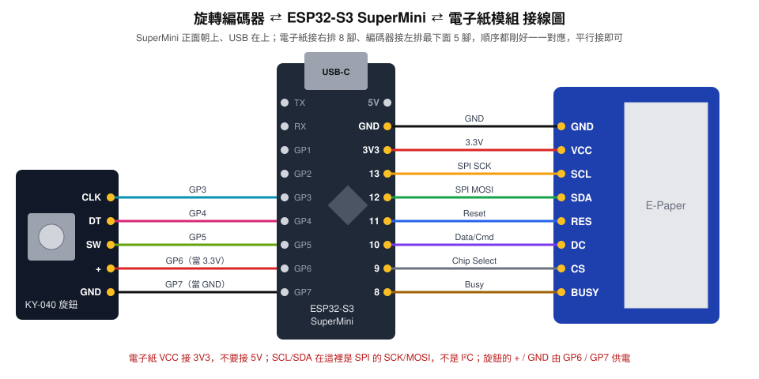

# Wi-Fi 電子紙名片（ESP32-S3 SuperMini）

ESP32-S3 SuperMini 加上 SPI 電子紙模組（腳位絲印 `GND VCC SCL SDA RES DC CS BUSY`）。
手機或電腦連上 ESP 的 Wi-Fi 熱點後，就能在瀏覽器裡用內建的**版面編輯器**設計畫面，再送到電子紙顯示。
最多可存 **8 頁**，每頁可以是一張靜態圖，或一段**動畫／影片**（定格動畫），用 **KY-040 旋轉編碼器**（或板載 BOOT 鍵、網頁）切換。
可以連上家裡或公司的區網，用 IP 開啟編輯器。

**運算分工：** 排版、文字繪製、圖片縮放、亮度/對比、抖色 (dithering)、QR Code 產生、影片擷取影格，**全部在你連上的手機/電腦瀏覽器裡完成**。
ESP 只接收最後的 1-bit 點陣圖，負責存檔與刷新電子紙，所以不需要在 ESP 上放中文字型或做影像處理。

## 編輯器功能

- **預覽框**：模擬電子紙外框，顯示的是實際會送出的黑白點陣（所見即所得）；可縮放
- **素材**：文字（多行、字級、黑體/明體/等寬、粗體、對齊、黑/白字）、圖片、QR Code、圖示（電話、郵件、網址、地點…）、方框、線條
- **移動與縮放**：直接拖曳；拖右下角紅點縮放；拖到中線會自動吸附；方向鍵微調（Shift 一次 10px）
- **圖片編輯器**：Atkinson / Floyd–Steinberg 抖色或黑白門檻、亮度、對比、負片、鎖定比例、更換圖片。圖片會先在瀏覽器縮小，原圖不會上傳
- **圖層**：上移/下移、複製、刪除、水平/垂直置中
- **復原/重做**（Ctrl+Z / Ctrl+Y）
- **版面**：橫向/直向（可倒轉 180°）、白底/黑底、一鍵名片範本
- **多張圖片**：預覽框上方有 1–8 的頁碼，每張圖都有自己的版面；可以指定螢幕顯示哪一張、刪除，綠點標示目前螢幕上那張
- **動畫 / 影片**：預覽框上方切到「動畫 / 影片」，選一段影片（MP4/WebM）或多張圖片（依檔名排序當定格動畫）。
  可設定擷取起點與長度、每秒幾格、填滿或完整顯示、轉換方式（推薦 Bayer 規則網點，動畫不閃爍）、亮度、對比、負片、每幾格全刷一次。
  預覽框會循環播放實際的黑白影格；送出後裝置用局部刷新播放（約每格 0.3–0.6 秒，所以效果是定格動畫，不是流暢影片）。
  儲存空間約可放 280 格（2.9 吋面板）。頁碼前面有 ▶ 的是動畫頁
- **存檔**：送出時會一併把版面檔（含圖片素材）存到 ESP，換另一支手機連上也能接著編輯；也能匯出/匯入 `.json` 版面檔備份

## 接線



### 電子紙

只用到 SuperMini **右排**排針（USB 朝上時，由上往下是 5V、GND、3V3、13、12、11、10、9、8），跳過 5V 後，順序剛好和模組一樣，8 條線平行接過去就好：

| 電子紙模組 | SuperMini | 用途 |
|---|---|---|
| GND  | GND  | |
| VCC  | **3V3** | 不要接 5V |
| SCL  | 13 | SPI SCK（不是 I²C） |
| SDA  | 12 | SPI MOSI（不是 I²C） |
| RES  | 11 | Reset |
| DC   | 10 | Data/Command |
| CS   | 9  | Chip Select |
| BUSY | 8  | 忙碌訊號 |

```
  ESP32-S3 SuperMini (右排)        電子紙模組
        5V  o  (不接)
       GND  o──────────────────────o GND
       3V3  o──────────────────────o VCC
        13  o──────────────────────o SCL
        12  o──────────────────────o SDA
        11  o──────────────────────o RES
        10  o──────────────────────o DC
         9  o──────────────────────o CS
         8  o──────────────────────o BUSY
```

### 旋轉編碼器 KY-040

接在 SuperMini **左排最下面 5 腳**（GP3–GP7），順序也和模組一樣，平行接過去就好：

| 編碼器 | SuperMini | 說明 |
|---|---|---|
| CLK | GP3 | |
| DT  | GP4 | |
| SW  | GP5 | 旋鈕按壓 |
| +   | GP6 | 韌體輸出 HIGH 當 3.3V 電源 |
| GND | GP7 | 韌體輸出 LOW 當地線 |

```
  KY-040                ESP32-S3 SuperMini (左排)
   CLK o──────────────────o GP3
    DT o──────────────────o GP4
    SW o──────────────────o GP5
     + o──────────────────o GP6
   GND o──────────────────o GP7
```

SuperMini 只有一組 3V3/GND 腳，已經給電子紙用了，所以編碼器的電源由 GP6/GP7 提供（編碼器耗電不到 1 mA，沒問題）。
如果你想把 + / GND 接到真正的 3V3 / GND（得自己分線），把 `config.h` 的 `ENC_VCC_PIN`、`ENC_GND_PIN` 改成 `-1`。

| 操作 | 動作 |
|---|---|
| 轉旋鈕 | 上一張／下一張（只在有圖的頁之間循環；連轉幾格就跳幾張，停下來才刷新） |
| 短按旋鈕 | 回到第 1 張 |
| 短按 BOOT 鍵 | 下一張 |
| 長按旋鈕或 BOOT 鍵 2 秒 | 在螢幕顯示 Wi-Fi 連線資訊 |
| 睡眠中按旋鈕或 BOOT 鍵 | 喚醒並切到下一張 |

轉一格卻跳兩張：把 `ENC_STEPS_PER_DETENT` 改成 `2`。轉向相反：把 `ENC_REVERSE` 改成 `1`。

腳位都可在 `firmware/epaper_namecard/config.h` 修改。

## 燒錄

1. 安裝 **Arduino IDE 2.x**。
2. 開發板管理員安裝 **esp32 by Espressif Systems 3.x**（已用 3.0.7 編譯驗證）。
3. 程式庫管理員安裝 **GxEPD2**（會自動帶入 Adafruit GFX）。
4. 開啟 `firmware/epaper_namecard/epaper_namecard.ino`，在 `config.h` 選擇面板型號（見下節）。
5. 工具選單：

   | 項目 | 設定 |
   |---|---|
   | 開發板 | **ESP32S3 Dev Module** |
   | USB CDC On Boot | **Enabled**（序列埠訊息才會從 USB 輸出） |
   | Flash Size | **4MB (32Mb)** |
   | Partition Scheme | **Default 4MB with spiffs (1.2MB APP/1.5MB SPIFFS)** |

6. 上傳。如果上傳失敗：按住 **BOOT**，按一下 **RESET**，放開 BOOT，再上傳一次。

### 面板型號

模組外觀相同的有 2.13"、2.66"、2.9" 幾種，看排線料號或賣場標題，在 `config.h` 選擇：

| `config.h` | 尺寸 / 解析度 | 驅動 IC | 常見料號 |
|---|---|---|---|
| `PANEL_213`     | 2.13" 122×250 | SSD1680 | GDEY0213B74、「V4」 |
| `PANEL_266`     | 2.66" 152×296 | SSD1680 | GDEY0266T90 |
| `PANEL_290_V2`（預設） | 2.9" 128×296 | SSD1680 | GDEY029T94、「V2」 |
| `PANEL_290_OLD` | 2.9" 128×296 | IL3820  | GDEH029A1、「V1」 |

選錯時會畫面偏移、只顯示一部分，或有雜點和嚴重殘影。換一個型號重燒即可。編輯器會自動依面板解析度調整畫布。

## 使用

1. 第一次開機時，螢幕會顯示熱點名稱與網址。
2. 手機連 Wi-Fi **`EPaper-Card-XXXX`**，密碼 **`12345678`**（可在 `config.h` 修改）。
3. 瀏覽器開 **http://192.168.4.1**，編輯器會載入名片範本。
4. 編輯完按 **「送到電子紙」**，約 2–4 秒刷新完成。
5. 想放第二張圖：點預覽框上方的 **2**，做好後再按「送到電子紙」。之後轉動旋鈕就能切換。
6. 放動畫：點一個頁碼，切到 **「動畫 / 影片」**，選影片或多張圖片，確認預覽後按「送到電子紙」。

### 連上區網，用 IP 編輯

1. 手機先連裝置的熱點，開 http://192.168.4.1 。
2. 到網頁的 **「連上區網 Wi-Fi」**，按 **掃描附近 Wi-Fi**，點選你的網路並填密碼，按 **儲存並重新連線**。
3. 連上後，網頁和**電子紙**都會顯示區網 IP（例如 `http://192.168.1.23`）。
4. 手機切回同一個區網，用瀏覽器開那個 IP（或 `http://epaper.local`）就能編輯。之後開機都會自動連上這個區網，熱點也一直開著。

- 只能連 **2.4GHz** Wi-Fi。顯示「找不到這個網路」通常是 5GHz 網路或訊號太弱；「連線失敗」多半是密碼錯誤。
- 裝置連上區網時，熱點可能換頻道，手機會短暫斷線；這時看電子紙上的 IP 即可。
- 忘記 IP：長按旋鈕或 BOOT 鍵 2 秒，電子紙會顯示連線資訊。
- Wi-Fi 密碼只存在裝置裡，不會寫進程式碼或上傳。

### 省電

- 電子紙斷電後畫面仍會保留，名片做好後可以直接拔電。
- 預設**不休眠**（`config.h` 的 `SLEEP_AFTER_MIN` 為 `0`）：Wi-Fi 一直開著，隨時都能用網頁控制，適合插 USB 長期使用。
- 接電池隨身帶時，建議把 `SLEEP_AFTER_MIN` 改成 `10`：閒置 10 分鐘且沒有手機連著熱點時，會進入深度睡眠，按**旋鈕**或 **BOOT** 鍵喚醒（睡眠中轉動旋鈕不會喚醒）。
- 這款 SuperMini 背面有電池焊盤（B+ / B−）和充電電路，可以接單顆鋰電池。

## 沒有畫面？疑難排解

1. **先看韌體有沒有在跑**：手機 Wi-Fi 清單有沒有出現 `EPaper-Card-XXXX`？
   - 沒有 → 韌體沒燒進去或沒啟動：確認上傳成功，按一下 RESET。
   - 有 → ESP 正常，問題在電子紙（接線或型號），往下看。
2. **檢查接線**：VCC 接 **3V3**（不是 5V）；SCL→13、SDA→12 沒有對調；GND 確實接上；杜邦線插緊（可以換一條試試）。
3. **找出正確的面板型號**：燒錄 `firmware/panel_test/panel_test.ino`，它會每 10 秒換一種驅動，畫出大大的編號 1–8。
   看哪個編號的畫面完整清楚，就在 `config.h` 選對應的型號，再燒回主韌體：

   | 編號 | 1 | 2 | 3 | 4 | 5 | 6 | 7 | 8 |
   |---|---|---|---|---|---|---|---|---|
   | config.h | `PANEL_290_V2` | `PANEL_213` | `PANEL_266` | `PANEL_290_OLD` | `PANEL_213_B74` | `PANEL_213_B73` | `PANEL_290_BS` | `PANEL_290_T5` |

4. **看序列埠訊息**（Arduino IDE 序列埠監控視窗，115200）：
   - 出現 `Busy Timeout!`：面板沒有回應，通常是接線問題或型號不對。
   - 每次刷新只花幾十毫秒：指令沒送到面板，請檢查 SCL/SDA/CS/DC 這幾條線。

## 在電腦上試用編輯器（不需要硬體）

```bash
python3 tools/dev_server.py            # 預設模擬 2.9" 128x296
python3 tools/dev_server.py --panel 152x296
```

用瀏覽器開 http://localhost:8000。按「送到電子紙」後，收到的點陣圖會存成 `tools/out/screen.png`。

## 修改網頁

編輯器原始碼在 `web/index.html`。修改後執行下面的指令，重新產生 `firmware/epaper_namecard/web_ui.h`（gzip 壓縮後內嵌到韌體），再重新燒錄：

```bash
python3 tools/build_web.py
```

## HTTP API

| 方法 | 路徑 | 說明 |
|---|---|---|
| GET  | `/api/info`    | 面板解析度、連線狀態（`sta`：none/connecting/connected/nossid/failed、`staip`）、`pages`（各頁 0 空白 / 1 靜態圖 / 2 動畫）、`cur`、`playing` 等 JSON |
| GET  | `/api/scan`    | 掃描附近 Wi-Fi：`[{ssid, rssi, lock}]` |
| POST | `/api/image?page=&w=&h=&rot=&fast=` | 存到第 page 頁（0 起算）並顯示；body 是 base64 的 1-bit 點陣（每列 (w+7)/8 bytes，MSB 在左，1＝黑） |
| GET/POST | `/api/layout?page=` | 讀取/上傳該頁版面檔（POST 用 multipart，欄位 `file`） |
| GET/POST | `/api/anim?page=` | 下載/上傳該頁動畫檔（POST 用 multipart，欄位 `file`）。格式：16 bytes 檔頭 `EPA1` w(2) h(2) rot(1) 格數(2) 每格毫秒(2) 每幾格全刷(1) 保留(2)，後接各格點陣（同 `/api/image`），數字為 little-endian |
| POST | `/api/stop`    | 停止播放動畫（停在目前這格） |
| POST | `/api/show?page=` | 螢幕切到該頁（動畫頁會開始播放） |
| POST | `/api/next`    | 螢幕切到下一張（等同按 BOOT） |
| POST | `/api/delete?page=` | 刪除該頁的圖/動畫與版面 |
| POST | `/api/wifi`    | `ssid`、`pass`（pass 留空表示不變更） |
| POST | `/api/redraw`  | 重刷目前這張 |
| POST | `/api/netinfo` | 在螢幕顯示連線資訊 |
| POST | `/api/clear`   | 清空螢幕 |
| POST | `/api/reboot`  | 重新開機 |

## 檔案

```
firmware/epaper_namecard/
  epaper_namecard.ino   韌體：Wi-Fi、網頁伺服器、接收點陣圖、多頁存檔、旋鈕/按鈕、休眠
  config.h              面板型號、腳位、旋鈕、熱點、休眠設定
  web_ui.h              自動產生（gzip 後的編輯器網頁）
web/index.html          編輯器原始碼
web/vendor/qrcode.js    QR Code 產生器（Kazuhiko Arase, MIT）
tools/build_web.py      產生 web_ui.h
tools/dev_server.py     本機模擬伺服器
firmware/panel_test/    面板型號測試程式（沒畫面時用）
docs/wiring.svg         接線圖
```

圖示採用 Material Icons（Apache 2.0）。
